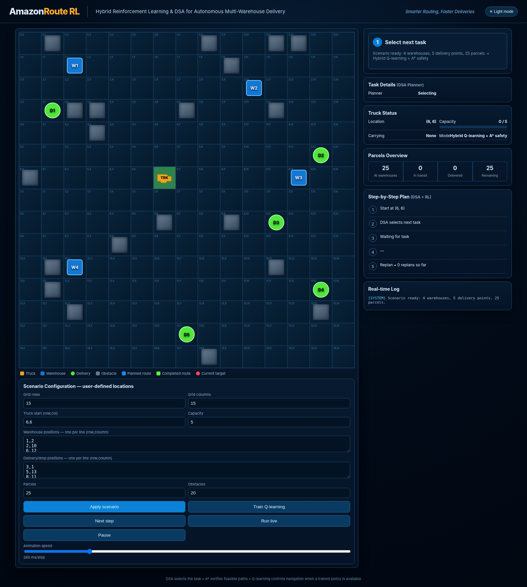
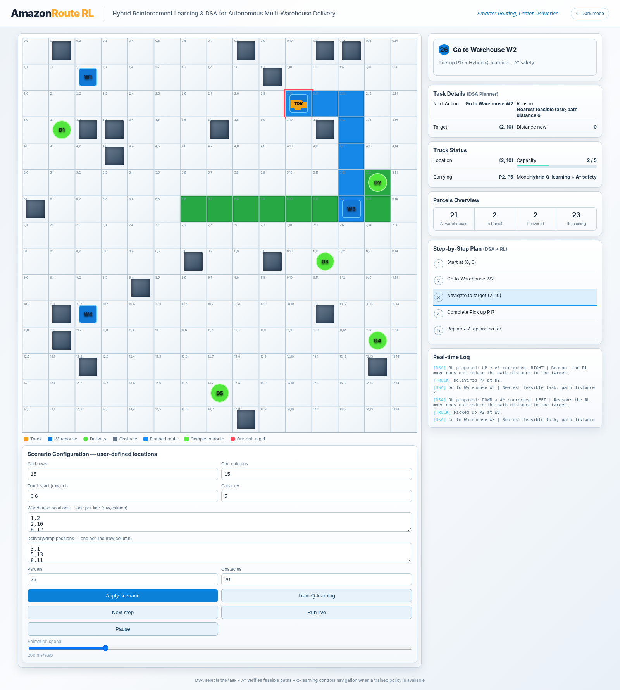
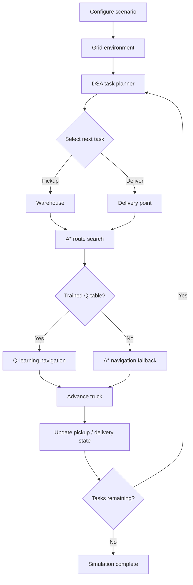

<div align="center">

# 🚚 AmazonRoute RL

### Intelligent Multi-Warehouse Delivery with Reinforcement Learning + Data Structures & Algorithms

**Plan smarter. Navigate obstacles. Track every delivery.**

[](https://www.python.org/)
[](#-how-it-works)
[](#-how-it-works)
[](#-interactive-dashboard)
[](#-project-notes)

[**Explore Dashboard**](#-interactive-dashboard) • [**Features**](#-key-features) • [**Get Started**](#-quick-start) • [**Architecture**](#-how-it-works) • [**Results**](#-training--evaluation) • [**Repository**](https://github.com/Sj3604/AmazonRoute)

</div>

---

## ✨ Project Overview

**AmazonRoute RL** is an interactive **autonomous delivery simulator** that combines **Data Structures & Algorithms (DSA)** with **reinforcement learning** to coordinate a single delivery truck across multiple warehouses and drop-off points.

Instead of making one model solve every logistics decision, the system gives each component a focused responsibility: the **DSA task planner** selects parcel pickups and deliveries, **A\*** calculates feasible obstacle-aware routes, and a **Q-learning navigator** learns grid movement. A built-in fallback uses A* routes when a trained policy is unavailable, so the dashboard can be explored right away.

> **Run locally:** This repository contains a local browser dashboard, **not a publicly hosted demo**. Start the Python server and open `http://127.0.0.1:8765`.

## 🖥️ Interactive Dashboard

<div align="center">

### 🌙 Dark-mode control room

<a href="screenshots/dashboard-dark.png"></a>

<sub>Actual screenshot of the running dashboard. Click the image to view full size.</sub>

</div>

<details>
<summary><b>📸 View more application screenshots (click to expand)</b></summary>

<br>

**🚦 Route progress — step-by-step movement and replanning**

<a href="screenshots/live-routing.png"></a>

**☀️ Light theme — same interactive simulation**

<a href="screenshots/dashboard-light.png"></a>

</details>

### 🎮 Dashboard controls

| Control | What it does |
| :-- | :-- |
| **Apply scenario** | Initialize a custom grid with truck, warehouse and destination positions |
| **Train Q-learning** | Train/load the navigation policy through the dashboard |
| **Next step** | Advance the simulation by one movement/action |
| **Run live** | Animate the simulation one step at a time |
| **Pause / Resume** | Temporarily stop or continue live animation |
| **Animation speed** | Adjust the interval between moves (80–1000 ms) |
| **Light / Dark mode** | Switch between two dashboard themes |

The dashboard also displays the **planned path**, **completed path**, **current target**, **parcel status**, **truck capacity**, **DSA task details**, and a **real-time event log**.

## 🚀 Key Features

| Feature | Details |
| :-- | :-- |
| 🧠 **Hybrid decision-making** | Separates task selection, path search, and learned navigation |
| 🏭 **Multi-warehouse simulation** | Configurable warehouse and delivery-point coordinates |
| 📦 **Priority-based parcels** | Planner considers parcel priority, travel distance, and truck capacity |
| 🗺️ **A* pathfinding** | Finds feasible paths across a grid containing obstacles |
| 🤖 **Q-learning agent** | Trains a tabular policy for movement decisions |
| 🔁 **Dynamic replanning** | Reconsiders tasks after pickup/delivery changes |
| 🚛 **Capacity constraints** | Tracks parcels carried and remaining truck capacity |
| 📊 **Visual analytics** | Training reward plots, evaluation output, and live state summaries |
| ✅ **Scenario validation** | Rejects invalid or duplicate positions and reserves important grid cells |

## ⚡ Quick Start

**Requirements:** Python 3.10+ and a modern browser. The source lists `numpy`, `matplotlib`, and `pandas` as Python dependencies.

**1. Clone the project**

```bash
git clone https://github.com/Sj3604/AmazonRoute.git
cd AmazonRoute
```

**2. Create and activate a virtual environment (recommended)**

```bash
python -m venv .venv
```

<details>
<summary><b>Activate the environment on your operating system</b></summary>

**Windows PowerShell**

```powershell
.\.venv\Scripts\Activate.ps1
```

**macOS / Linux**

```bash
source .venv/bin/activate
```

</details>

**3. Install the dependencies**

```bash
python -m pip install -r requirements.txt
```

**4. Start the dashboard**

```bash
python main.py
```

Alternatively, run `python app.py`. Then open **http://127.0.0.1:8765** if it does not open automatically. Press **Ctrl+C** in your terminal to stop the local server.

## 🧠 How It Works



| Component | Responsibility | Main file |
| :-- | :-- | :-- |
| **Environment** | Grid, obstacles, truck, warehouses, parcels, and delivery status | `environment.py` |
| **Task planner** | Prioritized pickup and delivery selection | `planner.py` |
| **Pathfinding / heap** | A* routing and priority-queue operations | `algorithms.py` |
| **RL navigator** | Q-learning movement policy and Q-table persistence | `rl_agent.py` |
| **Simulation** | Run environment actions, episodes, and metrics | `simulation.py` |
| **Dashboard server** | Local UI and application API endpoints | `app.py` |

<details>
<summary><b>🔍 Why use DSA + reinforcement learning together?</b></summary>

The planner can compare parcel priorities, distances, and available capacity without requiring Q-learning to encode every warehouse, parcel, and delivery decision. A* provides a feasible path around obstacles, while Q-learning focuses on movement. This modular architecture makes the decisions easier to inspect and debug.

</details>

## 🧩 Custom Scenario Configuration

Set your grid dimensions, truck start position, capacity, parcel count, and obstacle count in the dashboard. Enter one `row,column` pair per line for warehouse locations and delivery points.

**Example scenario:**

```text
Truck start: 6,6
Grid size: 15 x 15
Truck capacity: 5
Parcels: 25
Obstacles: 20

Warehouses:
1,2
2,10
6,12
10,2

Delivery points:
3,1
5,13
8,11
11,13
13,7
```

Coordinates must fit within the grid, and the application prevents duplicate locations and conflicting reserved positions.

## 📈 Training & Evaluation

**Train Q-learning from the command line**

```bash
python main.py --mode train --episodes 600
```

**Evaluate the saved model**

```bash
python main.py --mode evaluate
```

<div align="center">

### Training reward history

<a href="outputs/training_rewards.png"></a>

### Evaluation visualization

<a href="outputs/evaluation.png"></a>

</div>

**Generated artifacts:** `outputs/q_table.pkl` (saved policy), `outputs/training_metrics.csv` (episode metrics), `outputs/training_rewards.png` (training chart), `outputs/evaluation.json` (evaluation metrics), and `outputs/evaluation.png` (evaluation plot).

> **Important interpretation:** The supplied `outputs/evaluation.json` records **0 of 25 parcels delivered** in that saved evaluation run. The project also documents a separate successful **25/25-delivery A* fallback dashboard scenario** in `VERIFICATION.md`. These are different execution paths; the successful fallback run should **not** be presented as a trained Q-learning benchmark. Results depend on the policy and scenario.

## 🗂️ Project Structure

```text
AmazonRoute/
├── app.py                   # Browser dashboard and local HTTP API
├── main.py                  # Main command-line entry point
├── config.py                # Simulation and learning parameters
├── environment.py           # Grid-world delivery environment
├── models.py                # Parcel and vehicle data models
├── planner.py               # DSA-based task scheduling
├── algorithms.py            # A* and priority queue
├── rl_agent.py              # Q-learning navigator
├── simulation.py            # Episode simulation and metrics
├── train.py                 # RL training pipeline
├── evaluate.py              # Saved policy evaluation
├── visualization.py         # Visualization utilities
├── requirements.txt         # Python dependencies
├── PROJECT_NOTES.md         # Design reasoning and extensions
├── VERIFICATION.md          # Documented checks
├── assets/
│   └── screenshots/
│       ├── dashboard-dark.png
│       ├── live-routing.png
│       └── dashboard-light.png
└── outputs/
    ├── training_rewards.png
    ├── training_metrics.csv
    ├── evaluation.png
    ├── evaluation.json
    └── q_table.pkl
```

## 🔭 Future Improvements

Potential next steps: multi-truck coordination, traffic-aware routing, delivery deadlines, fuel/battery constraints, dynamic road closures, route baseline comparisons, and deep RL experiments (DQN/PPO).

## 📝 Project Notes

This is an **educational/research-oriented logistics simulator**. The dashboard is designed for local use, and no production deployment or public demo URL is specified in the repository. No license file was present in the supplied project; add a `LICENSE` file if you want to define reuse permissions.

For implementation details, see [Project Notes](PROJECT_NOTES.md) and [Verification Report](VERIFICATION.md).

---

<div align="center">

**Built to explore smarter routing through DSA, A* search, and reinforcement learning.**

⭐ If you found this project useful, consider starring the [GitHub repository](https://github.com/Sj3604/AmazonRoute).

[⬆ Back to top](#-amazonroute-rl)

</div>
